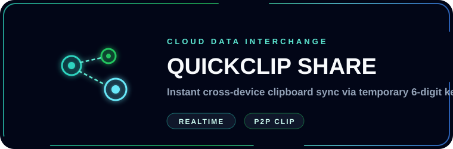

  <!-- ==================== HEADER BANNER ==================== -->
  

  <!-- Animated Typing HUD Line -->
  

   

  <!-- Verified Profile & Telemetry Badges -->
  

    
    
    
    
  

  <!-- Control Surface -->
  

    
  

  

    <a href="https://raj-patel.app"><b>🌐 Portfolio (raj-patel.app)</b></a>
      •  
    <a href="https://github.com/raj171205?tab=repositories"><b>⚡ Repositories</b></a>
      •  
    <a href="https://github.com/raj171205/JavaDSA"><b>☕ Java DSA</b></a>
      •  
    <a href="mailto:rajpatel171205@gmail.com"><b>🤝 Contact</b></a>
  

<!-- Animated Cyber Divider -->

  

<!-- ==================== SYSTEM ACCESS (FEATURED BUILDS) ==================== -->

  

  <!-- Primary System Portal -->
  

    

  <!-- Interactive Project HUD Cards -->
  

    
    
    
  

  <!-- Explore Repositories Button -->
  

    
  

<!-- Animated Cyber Divider (Mirrored) -->

  

<!-- ==================== SYSTEM CORE ==================== -->

  

<!-- Animated Data Capsule Divider -->

  

<!-- ==================== TECH STACK MATRIX ==================== -->

  <h3>🛠️ Verified Tech Stack</h3>

  <table border="0" cellspacing="12" cellpadding="8">
    <tr>
      <td width="270" align="center">
        <b>💻 Languages</b>  
        
      </td>
      <td width="270" align="center">
        <b>🌐 Frontend & Backend</b>  
        
      </td>
      <td width="270" align="center">
        <b>🗄️ Databases, Cloud & Tools</b>  
        
      </td>
    </tr>
  </table>

<!-- Animated Circuit Pulse Bar Divider -->

  

<!-- ==================== LIVE TELEMETRY & CODING METRICS ==================== -->

  <h3>📊 Live GitHub & LeetCode Activity</h3>

  

    
    
  

  

    
    
  

   
  

<!-- ==================== CONNECT & TERMINAL FOOTER ==================== -->

   
  <h3>📡 Connect With Me</h3>

  

    
     
    
     
    
     
    
  

   
  

  
<code>> B.Tech CSE @ LPU // Building Full-Stack & AI Applications 🚀</code>

