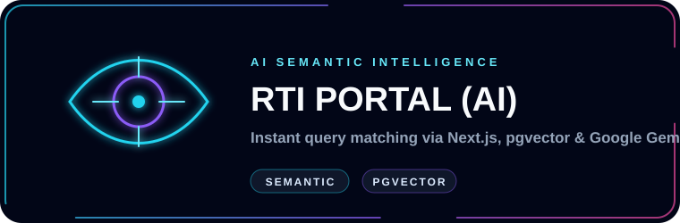

  <!-- ==================== HEADER BANNER ==================== -->
  

  <!-- Animated Typing HUD Line -->
  

   

  <!-- Status & Profile Badges -->
  

    
    
    
    
  

  <!-- Control Surface (From Screenshot) -->
  

    
  

  

    <a href="https://github.com/raj171205?tab=repositories"><b>⚡ Repositories</b></a>
    &nbsp;&nbsp;|&nbsp;&nbsp;
    <a href="https://github.com/raj171205/JavaDSA"><b>☕ Java DSA Core</b></a>
    &nbsp;&nbsp;|&nbsp;&nbsp;
    <a href="mailto:rajpatel171205@gmail.com"><b>🤝 Collaboration</b></a>
  

<!-- Animated Cyber Divider -->

  

<!-- ==================== SYSTEM ACCESS ==================== -->

  <!-- Section Title -->
  

  <!-- Primary System Portal (Centerpiece) -->
  

    

  <!-- Interactive Project HUD Cards (3 columns from screenshot) -->
  

    
    
    
  

  <!-- Glowing Action Button -->
  

    
  

<!-- Animated Cyber Divider (Mirrored) -->

  

<!-- ==================== SYSTEM CORE ==================== -->

  

<!-- Animated Data Capsule Divider -->

  

<!-- ==================== TECH STACK MATRIX ==================== -->
<h3 align="center">🛠️ Technical Arsenal &amp; Capabilities</h3>

  <!-- Interactive Dark Skill Icons -->
  

    

  <!-- Structured Category Grid -->
  <table border="0" cellspacing="10" cellpadding="0">
    <tr>
      <!-- Languages -->
      <td width="260" valign="top" align="center">
        <h4>💻 Core Languages</h4>
        &nbsp;&nbsp;
        &nbsp;&nbsp;
        &nbsp;&nbsp;
        
      </td>

      <!-- Full-Stack & APIs -->
      <td width="300" valign="top" align="center">
        <h4>🌐 Web Architecture</h4>
        &nbsp;&nbsp;
        &nbsp;&nbsp;
        &nbsp;&nbsp;
        &nbsp;&nbsp;
        
      </td>

      <!-- Database & Systems -->
      <td width="260" valign="top" align="center">
        <h4>🗄️ Data &amp; DevOps</h4>
        &nbsp;&nbsp;
        &nbsp;&nbsp;
        &nbsp;&nbsp;
        
      </td>
    </tr>
  </table>

<!-- Animated Circuit Pulse Bar Divider -->

  

<!-- ==================== LIVE STATS & TELEMETRY ==================== -->
<h3 align="center">📊 Real-Time GitHub Telemetry</h3>

  

    

  

<!-- ==================== CONTRIBUTION SNAKE ==================== -->

   
  

<!-- ==================== CONNECT & TERMINAL FOOTER ==================== -->

   
  <h3>📡 Transmit Signal / Contact Vector</h3>

  

    
    &nbsp;
    
    &nbsp;
    
    &nbsp;
    
  

   
  

  
<code>&gt; SYSTEM STATUS: READY_TO_COLLABORATE // KEEP_BUILDING 🚀</code>

